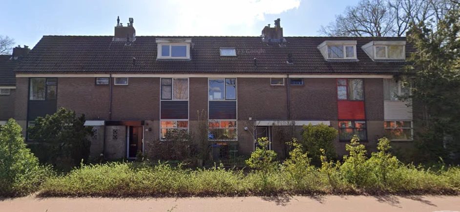
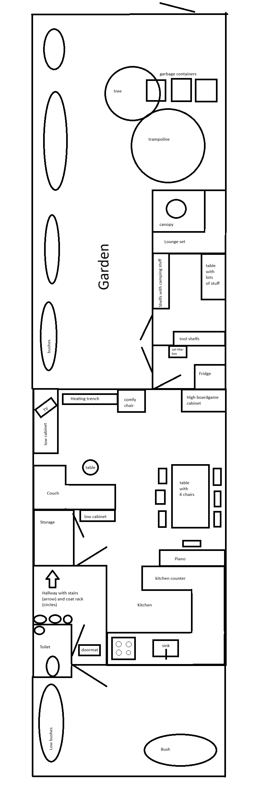

# Lennie's house: design notes

The game's house and street are based on the real ones, and Lennie on the real Lennie. This folder keeps the reference material they were built from.

## Lennie

*[lennie-face.jpg](lennie-face.jpg): the real Lennie, the reference for the ragdoll's face.*

- Short dark brown hair with a receding hairline, dark rectangular glasses, a short beard going grey, and a big friendly smile.
- In the game (`src/ragdoll.js`) Lennie is 1.90 m and 100 kg, in a worn hoodie and joggers. His face follows the photo, with the hair a bit thinner and further receded: short dark brown hair, sparse on top with the temples bare and fuller at the back and sides, fair skin, dark eyebrows, dark rectangular glasses, a short salt-and-pepper beard that's greyest on the chin with a neat moustache, and a big toothy smile.

## The street: a block of five rowhouses

*[rowhouses-street.webp](rowhouses-street.webp): the real block, seen from the street.*

- A block of five 1970s brick rowhouses under one long, dark tiled roof. **Lennie's house is the second from the left.**
- Each house has small high windows and the front door with a flat canopy on one side, and a tall window column with a coloured panel between the two floors on the other side. The houses are mirrored in pairs: Lennie's window column sits next to the one of the house on its right, and his small windows sit next to those of the house on his left.
- Panel colours from left to right: dark grey, dark blue (Lennie), dark blue, red (with red window frames), white.
- On the roof: a dormer above Lennie's window column, chimneys, a roof window on the house to his right, and dormers on the two houses at the right.
- In the game (`src/street.js`, `src/house.js`) the four neighbours are solid scenery Lennie bounces off. There are no other houses.

## The ground floor (floor 1) and the back garden

*[floorplan-floor1.png](floorplan-floor1.png): the owner's rough sketch. The street is at the bottom, the back garden at the top.*

The game's house is wider than the real one (12 m instead of about 5.5 m) to make room for tossing Lennie about, so the sketch is stretched sideways. Seen from the street:

- **The front garden:** open to the street, with low bushes all down the left side, a big bush on the right out by the low hedge along the cycle path, and a small path to the front door.
- **Front left:** the toilet (the loo against its front wall, a small hand basin, framed photos of friends on the walls). It sticks out of the front of the house beside the front door, under the canopy, with its small high window in front; the neighbours' toilets do the same, except on the dark blue house to the right. Next to it the hallway with the front door, the doormat, the coat rack and the stairs going up along the left wall.
- **Under the stairs:** the storage cupboard, with its door onto the living room.
- **Front right:** the kitchen, a U of counters with the cooker and the sink under the front window. A steel extractor hood above the cooker, hanging cupboards on the side wall above the counter, and pot plants on the window sill. It's open to the living room, behind the counter.
- **The back, all across:** the living room, with white walls and ceiling and the kids' drawings and paintings on the walls. The TV on a low cabinet in the back left corner, turned towards the dark grey corner couch, which is as long as the low white cabinet behind it, with a small round side table in front of it; the dark grey comfy chair and the tall board game cabinet against the back wall; the dining table with six chairs; the piano with its back to the kitchen counter. No rug.
- **The back wall:** one big window frame onto the garden, a wide pane with a side window, and a convector heating trench with a wooden grille in the floor along it, from the TV's corner to the comfy chair.
- **Floors:** the laminate runs from the front to the back.
- **Walls and ceilings:** the living room, the kitchen, the toilet (tiles only on its floor), the bedrooms and the attic have white painted walls; the ceilings everywhere are a light off-white, just set apart from the walls. The hallways, the landing, the utility room and the attic bathroom keep their own look.
- **Doors:** all the inside doors are white. The doors to the hallway, the utility room and the garden have glass panes, top and bottom.
- **Built on at the back (right):** the utility room with the fridge and the cat's litter box. A door from the living room, a door out to the garden.
- **The garage:** behind the utility room, its door near the utility room in the side facing the garden. Inside: shelves with camping stuff along the garden side, a table with lots of stuff against the far side, and tool shelves against the utility room. In the game the door stands wide open, so Lennie can be thrown in.
- **The back garden:** bushes all along the left fence; down the right-hand side the garage, the lounge set in the corner behind it (a corner sofa against the garage and along the fence, with a small round table in front, all under a flat see-through plastic canopy fixed to the garage wall and the fence, with a wooden post at the corner that hangs out), the round trampoline, and the three wheelie bins by the gate in the back fence, with a tree just left of them whose crown hangs over the first bin and the trampoline.

Floor 2 keeps its bedroom and kids room. The stairs now arrive in a corridor along the left wall, which leads to the landing at the back, where the stairs to the attic are.
